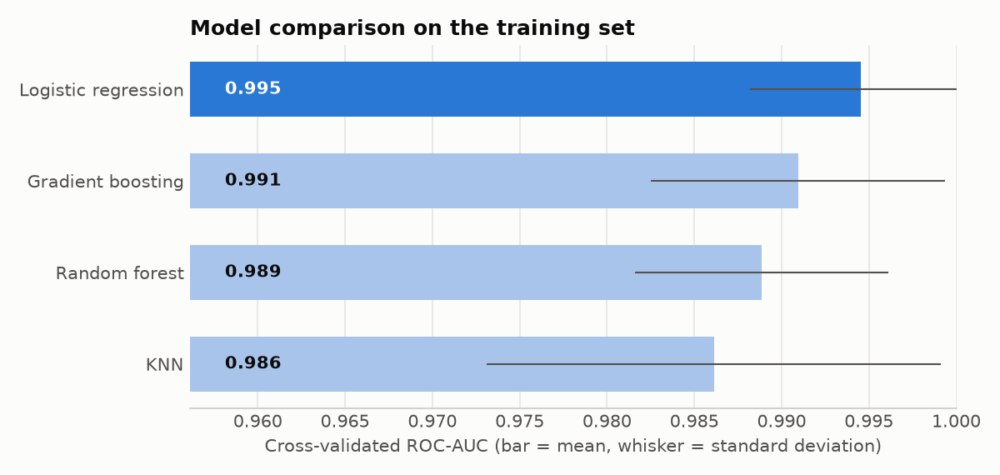
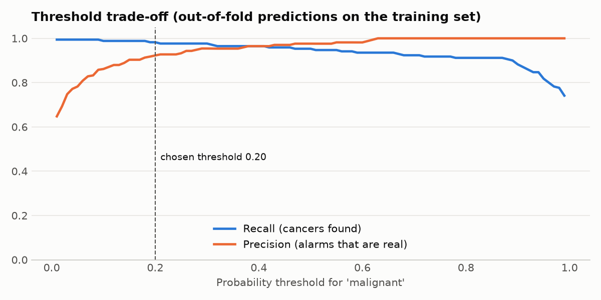
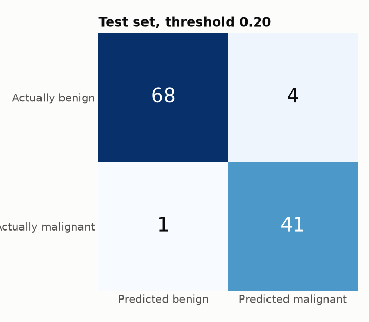

# Breast Tumour Classification: A Careful Model Evaluation

Classifying tumours as **malignant or benign** from measurements of cell nuclei in a biopsy image. The focus is not only on getting a high score, but on evaluating the model **honestly**: a test set touched only once, cross-validation for model choice, a decision threshold chosen for a business reason, and confidence intervals for the final result.

> This is a learning project, not a medical device.

## Dataset

Wisconsin Diagnostic Breast Cancer dataset, included in scikit-learn (nothing to download): 569 tumours, 30 measurements (mean, error and worst value of 10 properties such as radius, texture, concavity). 212 tumours (37.3%) are malignant.

## Approach

1. **Split:** 80% training (455) and 20% test (114), stratified. The test set is used once, at the end.
2. **Model choice:** 4 models (logistic regression, KNN, random forest, gradient boosting) compared with 5-fold cross-validation repeated 5 times, on the training set only.
3. **Threshold:** missing a cancer is worse than a false alarm, so the decision threshold is chosen on out-of-fold predictions to find at least 98% of malignant tumours.
4. **Final test:** recall and precision with 95% Wilson confidence intervals.
5. **Checks:** permutation importance on correlated features and probability calibration.

## Results

| Model | CV ROC-AUC | CV recall (threshold 0.5) | CV precision |
|---|---|---|---|
| **Logistic regression** | **0.995** | 0.953 | 0.979 |
| Gradient boosting | 0.991 | 0.933 | 0.966 |
| Random forest | 0.989 | 0.927 | 0.956 |
| KNN | 0.986 | 0.918 | 0.989 |

The simplest model won, and the differences between models are small compared with their fold-to-fold variation.

**Test set (114 tumours, 42 malignant), ROC-AUC 0.996:**

| Threshold | Cancers found | Cancers missed | False alarms | Recall (95% CI) | Precision |
|---|---|---|---|---|---|
| 0.5 (default) | 39 | 3 | 1 | 92.9% (81.0 to 97.5) | 97.5% |
| **0.20 (chosen)** | **41** | **1** | **4** | **97.6% (87.7 to 99.6)** | 91.1% |

Lowering the threshold from 0.5 to 0.20 turned 2 missed cancers into found ones at the price of 3 more false alarms.





## Insights

- **Accuracy alone is misleading:** always answering "benign" gives 62.7% accuracy and finds no cancers.
- **Shape measurements separate the classes best:** "worst concave points", "worst perimeter" and "mean concave points" have the largest difference between malignant and benign (Cohen's d around 2.6).
- **Many features are correlated** (21 pairs with correlation above 0.9, such as radius, perimeter and area), so permutation importance is spread across several features and should not be read as "the most important one".
- **The confidence intervals are wide** (87.7% to 99.6% recall) because only 42 malignant tumours are in the test set. One missed cancer more or less would change the result noticeably.

## Limitations

- A small dataset (569 tumours) from one source; the result may not hold for other hospitals or imaging equipment.
- The features come from already segmented biopsy images, not from raw images.
- The threshold reflects an assumption (finding cancers matters more than avoiding false alarms); in practice it would be set with doctors.
- Numbers can differ slightly between scikit-learn versions.

## How to run

```bash
pip install -r requirements.txt
python breast_cancer_analysis.py
```

No data download is needed.

## Project structure

```
breast_cancer_analysis.py   whole analysis: data, models, threshold, test, charts
results/                    tables (model comparison, test results, importance) and findings.txt
images/                     charts
```

---
Alizhan Islam |https://www.linkedin.com/in/alizhan-islam-960790362| alizhan1809@gmail.com
